  
  
  

I'm a software engineer who loves creative projects, from games to robotics. Lately that means a lot of **building with AI**: my portfolio is a sea you sail around, and my Claude Code sessions talk back to me out loud.

### 🏝️ Islands on the chart

| | Project | What it is | Built with |
|---|---|---|---|
| ⛵ | **[amidships.dev](https://amidships.dev)** | My portfolio, as a night sea you sail with the keyboard. Each island is a project. It runs on a hand-written Canvas 2D engine with no game libraries, has a CMS, and sends contact notes to a 58mm thermal printer on my desk as messages in bottles. | React 19 · React Router · TypeScript · Canvas 2D · Web Audio |
| 📐 | **[AmplifiED](https://amplifieddisplays.co.uk)** | Made-to-measure display boards for schools, with an order pipeline behind the shop that runs itself. | Shopify Hydrogen · Admin API · Supabase · Resend · Tailwind |
| 🎙️ | **Parley** | Talk to Claude Code by voice. You hold a hotkey and speak, your words go to the session you picked, and the reply is read back in an ElevenLabs voice. | Python · Claude Agent SDK · ElevenLabs |
| 🃏 | **mtg-scout** | Watches classified listings for Magic: The Gathering collections whose sellers don't know what they have, scores them, and posts only the real bargains to Discord. | Python · SQLite · Scryfall |
| 🔩 | **Still in the forge** | A few more islands are still under construction, including some ESP32 tinkering. | C++ · PlatformIO |

### 🧭 Toolbox

  
  
  
  
  
  
  
  
  
  
  
  
  

I care a lot about **accessibility**, **web performance** and **testing**: the work that doesn't show up in a screenshot.

### ⚓ Ashore

You'll find me 🧗 rock climbing, 🏍️ on a motorbike, 🏁 at the race track, or 🃏 shuffling up for Magic: The Gathering.

---

  Want to build something fun together? <a href="https://amidships.dev/contact">Send a message in a bottle</a> and it'll wash up on my printer.

