  
  
  

I'm a software engineer building things to keep my brain wrinkled. I love automation and building projects that are just.. fun? I'm continuously building with AI, using the latest strategies and workflows to maximize output and productivity.

### 🔦 Spotlight

My portfolio is a night sea you sail with the keyboard, and each island is a project. It runs on a hand-written Canvas 2D engine with no game libraries, and notes sent through the contact page print on a thermal printer on my desk. **[Take the helm →](https://amidships.dev)**

### 🧭 Toolbox

  
  
  
  
  
  
  
  
  
  
  
  
  

---

  Want to build something fun together? <a href="https://amidships.dev/contact">Send a message in a bottle</a> and it'll wash up on my printer.

